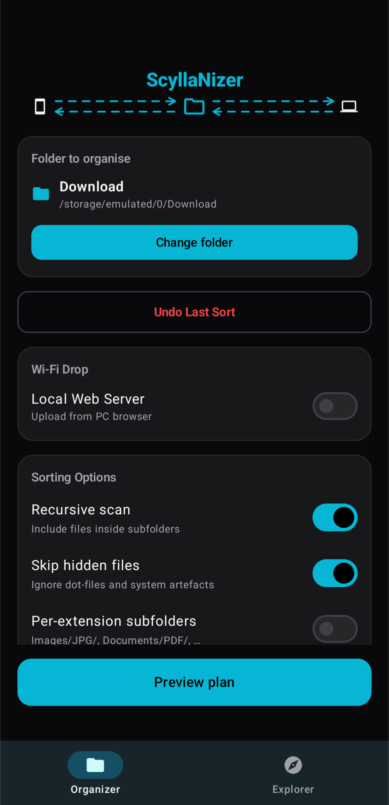
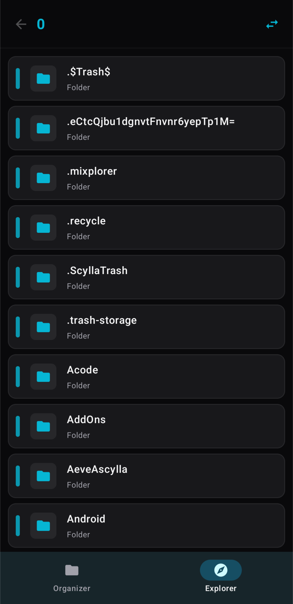

# ScyllaNizer

[](https://github-store.org/app?repo=AeveaScylla/ScyllaNizer)

ScyllaNizer is an Android file organizer built with Kotlin and Jetpack Compose. Choose a folder, configure the organization options, review the proposed changes, and then apply them. The app also includes an explorer to browse files and manage them more easily.

## Screenshots

| Organizer | Explorer |
| --- | --- |
|  |  |

## Get the app

Download ScyllaNizer from the [GitHub Store](https://github-store.org/app?repo=AeveaScylla/ScyllaNizer).

## Features

- Select a folder and configure organization options.
- Preview proposed changes and review selections before confirming.
- Undo changes from the results screen.
- Browse files with the built-in Explorer.
- Add exclusions and choose whether to shred files through the organizer options.

ScyllaNizer needs access to device storage to organize and browse files. Android may ask you to grant storage access before you can use these features.

## Build

Open this project in Android Studio and run the `app` configuration, or build it from the project root with:

```bash
./gradlew assembleDebug
```

The app is built with Kotlin, Jetpack Compose, and Android Gradle Plugin. The configured minimum Android SDK is 26.

## License

The project is licensed under the MIT License, with a restriction on use of the ScyllaNizer app name. See [LICENSE](LICENSE) for details.
