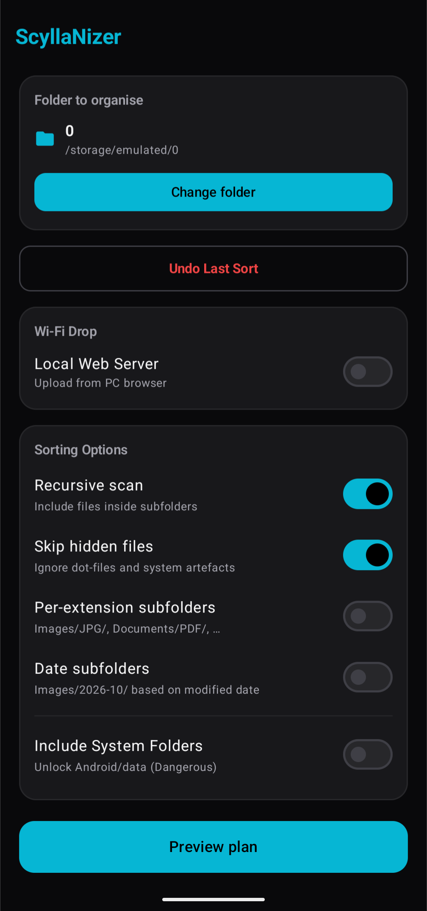
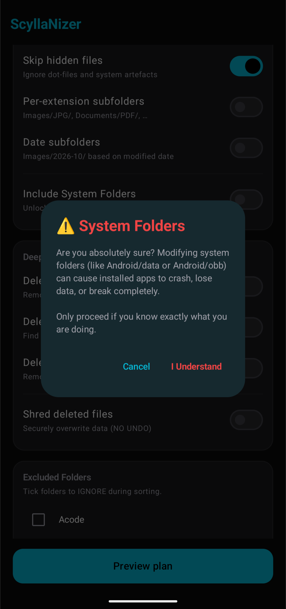
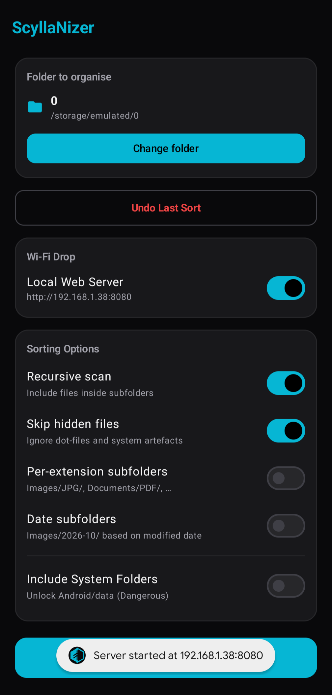
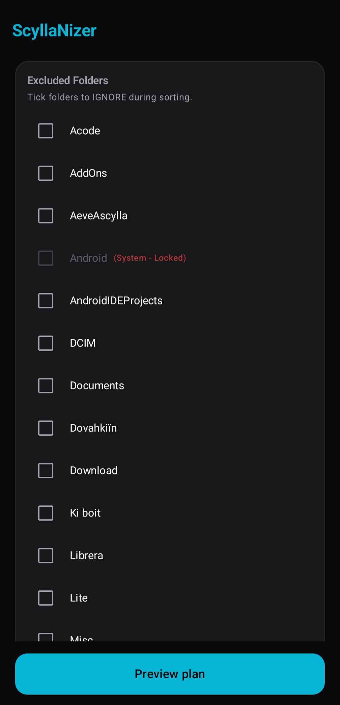

# 🐉 ScyllaNizer

[](https://github-store.org/app?repo=AeveaScylla/ScyllaNizer)
[](https://github.com/AeveaScylla/ScyllaNizer/releases/latest)

**ScyllaNizer** is a sleek, powerful, and ultra-fast file organizer for Android. It scans any folder (including `Download` and root storage), categorizes files by extension, and safely moves them where they belong while preserving your structure.

Built with **Kotlin** and **Jetpack Compose**, ScyllaNizer features a glossy black and electric cyan UI that adapts perfectly to both phones and tablets.

## ✨ Features

- **Full Storage Access:** Bypasses Android Scoped Storage using `MANAGE_EXTERNAL_STORAGE` to organize `Download`, `DCIM`, or any folder.
- **Dry-Run Preview:** See exactly what will move, where it will go, and what will be renamed before a single file touches the disk.
- **Smart Sorting:** Automatically categorizes files into images, videos, audio, documents, archives, apps, fonts, code, design, and others.
- **Customizable Structure:** Optionally sort into per-extension or date-based subfolders.
- **Folder Exclusions:** Skip folders like Telegram or WhatsApp.
- **Duplicate Protection:** Auto-renames conflicts without overwriting originals.
- **Persistent Undo:** Revert the last sort operation instantly.
- **Deep Cleanup:** Find and remove duplicate files, 0-byte files, and empty folders.
- **System Lock:** Protect critical `Android/data` folders by default.
- **Wi‑Fi Drop (HTTP Server):** Receive files from a PC over a local Wi‑Fi network.
- **Adaptive UI:** Responsive two-column layout on tablets and a smooth single-column layout on phones.

## 📸 Screenshots

<div align="center">
  <table>
    <tr>
      <td></td>
      <td></td>
    </tr>
    <tr>
      <td></td>
      <td></td>
    </tr>
  </table>
</div>

## 🛠️ Build & Install

1. Clone this repository:
   ```bash
   git clone https://github.com/AeveaScylla/ScyllaNizer.git
   cd ScyllaNizer
   ```
2. Open the project in Android Studio.
3. Sync Gradle and run the app on a device or emulator.

## 📦 License

This project is licensed under the MIT License. See [LICENSE](LICENSE) for details.

## 🔗 Project links

- GitHub: https://github.com/AeveaScylla/ScyllaNizer
- Releases: https://github.com/AeveaScylla/ScyllaNizer/releases
- Komi Store: https://github-store.org/app?repo=AeveaScylla/ScyllaNizer
