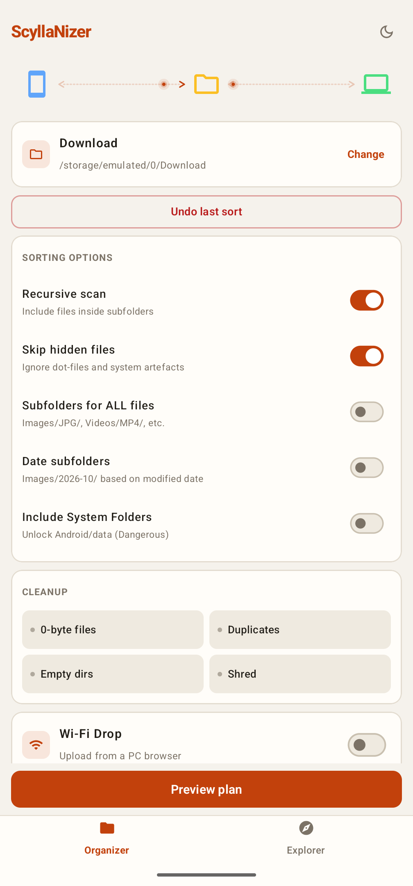
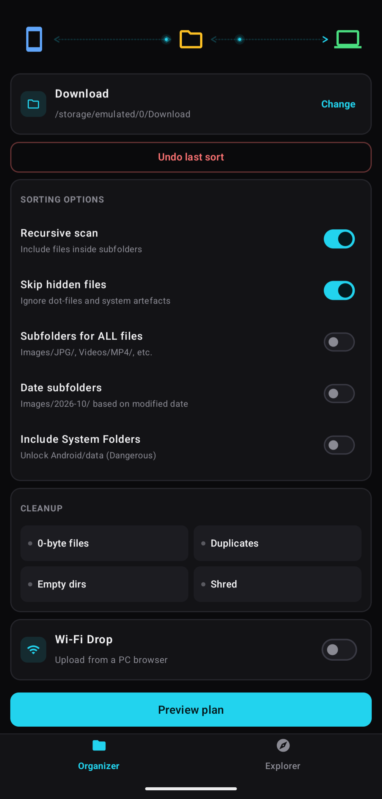

# 🐉 ScyllaNizer

**ScyllaNizer** is a sleek, powerful, and ultra-fast file organizer and explorer for Android. It scans any folder, categorizes files by extension, and safely moves them with a full dry-run preview.

Built with **Kotlin** and **Jetpack Compose**, ScyllaNizer features a glossy black and electric cyan interface for phones and tablets.

[](https://github-store.org/app?repo=AeveaScylla/ScyllaNizer)
[](https://github.com/AeveaScylla/ScyllaNizer/releases/latest)

## Features

### Organizer
- **Full Storage Access:** Organize files in selected shared-storage folders using Android's All files access permission.
- **Dry-Run Preview:** Review planned moves and cleanup actions before applying them.
- **Smart Sorting:** Categorizes files into Images, Videos, Audio, Documents, Archives, Apps, Fonts, Code, Design, and Others.
- **Deep Cleanup:** Find duplicate files, zero-byte files, and empty folders.
- **Wi-Fi Drop:** Receive files from a PC browser over the same local Wi-Fi network using the built-in local web server.
- **Persistent Undo:** Revert the last sort operation.

### Explorer
- **Dual-Pane Layout:** Browse two folders side-by-side on supported large screens.
- **File Management:** Copy, cut, paste, and delete files; extract ZIP archives.
- **Image Thumbnails:** View image previews while browsing.

## Distribution builds

The project provides two release flavors:

- **GitHub:** `./gradlew assembleGithubRelease` — includes the GitHub release-checking component.
- **IzzyOnDroid:** `./gradlew assembleIzzyRelease` — excludes the in-app GitHub updater; updates are delivered by the IzzyOnDroid repository.

Both flavors use the same application ID. Only install one distribution at a time, and keep the same developer release keystore for every update.

Release signing is configured through a local, untracked `signing.properties` file in the project root. Never commit that file or the `signing/` directory.

Example:

```properties
storeFile=signing/scyllanizer-release.jks
storePassword=YOUR_KEYSTORE_PASSWORD
keyAlias=scyllanizer
keyPassword=YOUR_KEY_PASSWORD
```

## Screenshots

| Organizer | Explorer |
| --- | --- |
|  |  |

## Build

Clone the repository and open it in Android Studio, or build a debug APK:

```bash
./gradlew assembleGithubDebug
```

The app uses Kotlin, Jetpack Compose, and Android Gradle Plugin. Minimum Android SDK: 26.

## License

The software is licensed under the MIT License. The ScyllaNizer name and branding are covered separately by [TRADEMARK.md](TRADEMARK.md).
