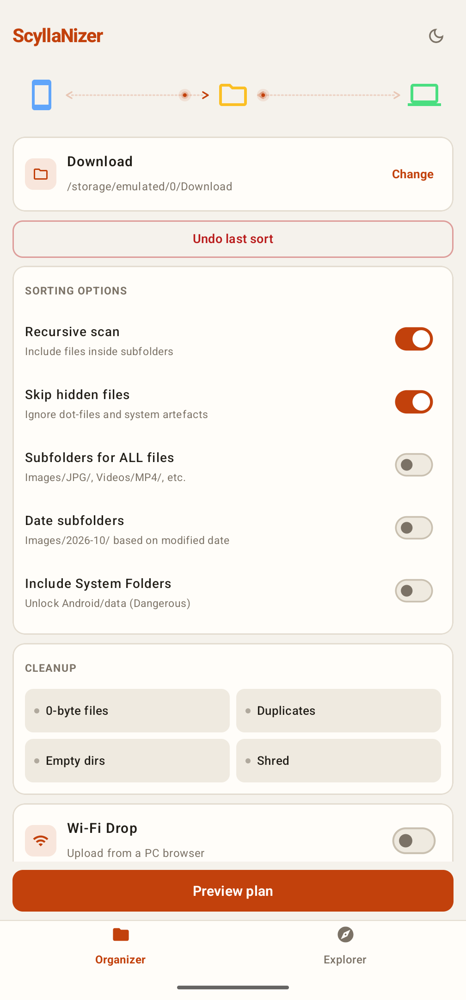
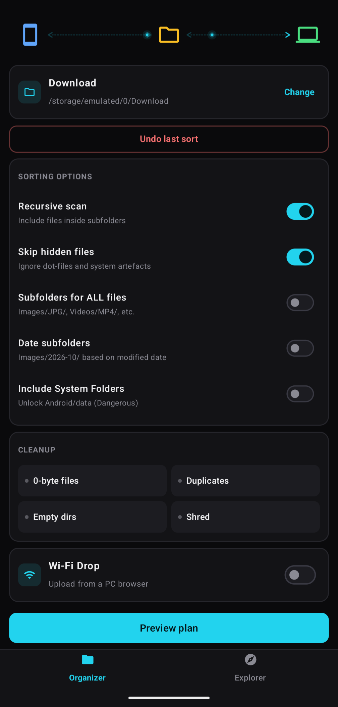
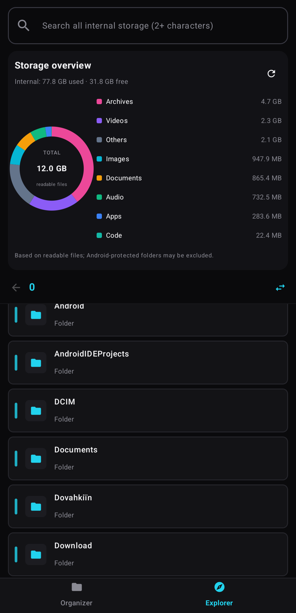
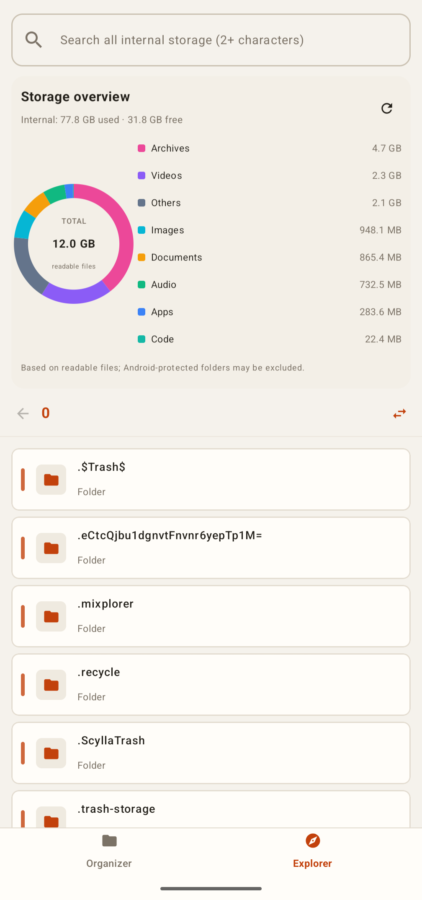

# 🐉 ScyllaNizer

**ScyllaNizer** is a sleek, powerful, and ultra-fast file organizer and explorer for Android. It scans any folder, categorizes files by extension, and safely moves them with a full dry-run preview.

Built with **Kotlin** and **Jetpack Compose**, ScyllaNizer features a gorgeous "Glossy Black & Electric Cyan" UI that adapts perfectly to both phones and large tablets.

[](https://github-store.org/app?repo=AeveaScylla/ScyllaNizer)
[](https://github.com/AeveaScylla/ScyllaNizer/releases/latest)

## ✨ Features

### 🗂️ The Organizer
- **Full Storage Access:** Bypasses Android Scoped Storage (using `MANAGE_EXTERNAL_STORAGE`) to organize `Download`, `DCIM`, or any folder.
- **Dry-Run Preview:** See exactly what will move, where it will go, and what will be renamed *before* a single file touches the disk.
- **Smart Sorting:** Automatically categorizes files into Images, Videos, Audio, Documents, Archives, Apps, Fonts, Code, Design, and Others.
- **Deep Cleanup:** Find and remove duplicate files (via MD5 hash), 0-byte files, and empty folders.
- **System Lock:** Protects critical `Android/data` folders by default to prevent accidental breakage.
- **Wi-Fi Drop (HTTP Server):** Turn on the built-in local web server and drag-and-drop files from your PC browser directly to your phone over your local Wi-Fi network.
- **In-App Updates:** Automatically checks GitHub for the latest release and prompts you to download it.
- **Persistent Undo:** Revert the last sort operation instantly.

### 📁 The Explorer
- **Dual-Pane Layout:** On tablets, browse two folders side-by-side. Copy files from the left pane and paste them into the right pane effortlessly.
- **X-Ray View:** Every file gets a color-coded vertical bar, instantly showing you which category the Organizer will place it in.
- **File Management:** Long-press to multi-select files to Copy, Cut, Paste, or Delete. You can also extract `.zip` files directly in the app.
- **Image Thumbnails:** The Explorer generates instant visual previews for your images.

## 📱 Screenshots

| Screenshot 1 | Screenshot 2 |
| --- | --- |
|  |  |

| Screenshot 3 | Screenshot 4 |
| --- | --- |
|  |  |

## 🤔 How does ScyllaNizer compare?

ScyllaNizer is not the only project of its kind, but its combination of glossy aesthetics, a built-in PC drag-and-drop server, and dry-run previews makes it distinctive.

### Direct Open-Source Alternatives
- **FilePipe:** An open-source alternative focused on automated sorting using smart rules.
- **AnExplorer:** An open-source file explorer with sorting features across phones, tablets, and Android TVs.
- **Pile:** A privacy-first, offline app designed to organize clutter and documents with tags.

### Why ScyllaNizer Stands Out
ScyllaNizer combines traditional file management with automatic organization:
1. **No complex rules to set up**—just pick a folder and tap Scan.
2. **100% offline and private**—no cloud AI reading your files.
3. **Wi-Fi Drop**—receive files from a PC using the built-in local HTTP server.
4. **Full dry-run preview and checkboxes**—review moves or deletions before they happen.

## 🛠️ Build & Install

1. Clone this repository:
   ```bash
   git clone https://github.com/AeveaScylla/ScyllaNizer.git
   ```
2. Open the project in Android Studio and run the `app` configuration, or build it from the project root with:
   ```bash
   ./gradlew assembleDebug
   ```

The app is built with Kotlin, Jetpack Compose, and Android Gradle Plugin. The configured minimum Android SDK is 26.

## License

The project is licensed under the MIT License, with a restriction on use of the ScyllaNizer app name. See [LICENSE](LICENSE) for details.
